# TI84-SAT

**A complete SAT toolkit for the TI-84 graphing calculator.** It has math solvers that show exact answers, a full **Trig Center**, a formula reference, a Reading & Writing guide, practice quizzes, and test-day strategy, all in one menu-driven program.

<p align="center">
  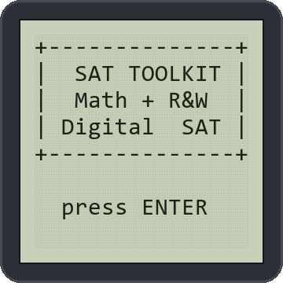
</p>

<p align="center">
  <a href="https://github.com/aidanbologna/TI84-SAT/releases/latest"><b>⬇ Download the latest release</b></a>
  &nbsp;·&nbsp; Works on the TI-84 Plus CE and the older TI-84 Plus / Silver Edition
</p>

---

## Contents

- [Features](#features)
- [Trig Center](#trig-center)
- [Screenshots](#screenshots)
- [Which file do I need?](#which-file-do-i-need)
- [Install](#install)
- [Controls](#controls)
- [Solver reference](#solver-reference)
- [Building from source](#building-from-source)
- [Testing](#testing)
- [Project layout](#project-layout)
- [Notes](#notes)

## Features

| | |
|---|---|
| 🧮 **Math Solvers** | Quadratics with **exact radical roots** like `(2+√(10))/2`, 2×2 systems, lines from two points, exponential growth, six percent tools, circles from general form, arcs and sectors, statistics, a missing-value finder, and degrees ↔ radians |
| 📐 **Trig Center** | An **any-triangle solver** (enter any sides, angles or area), right and special triangle solvers, a unit circle explorer, cofunction equations, the laws of sines and cosines, similar triangles, 6 lessons, and a 10-type trig quiz. Every answer is in exact SAT form, like `2√(5)/5` |
| 📏 **Math Formulas** | 11 topics in about 35 pages, from linear equations to probability |
| 📖 **Reading & Writing Guide** | Punctuation, grammar, transitions, student-notes questions, reading question types, R&W pacing |
| ✏️ **Practice Quiz** | Endless random math (10 types) and trig (10 types) questions, plus 18 grammar questions with explanations, all with score tracking |
| 🎯 **Test Strategy** | Digital SAT format, adaptive modules, rules for typed answers, test-day checklist |

Answers show as **fractions** wherever possible (`4/3`, not `1.333333333`), and square roots are **simplified** (`2√(5)`), which matches how SAT answer choices are written.

## Trig Center

Trig is where most students lose points on SAT Math, so it gets its own section. Every trig answer goes through an **exact-value engine**: it finds the simplest `p√(q)/d` form of any value whose square is a fraction with a denominator up to 9999, which covers every SAT triangle and unit-circle value. For anything else it falls back to a decimal.

### Any triangle: enter what you know, get everything back

Fill in whatever you know about **any** triangle (sides a, b, c, angles A, B, C, and the area), and leave the rest as 0. The solver works out which case you gave it and solves the triangle:

| You know | Case |
|---|---|
| 3 sides | SSS |
| 2 sides + the angle between them | SAS |
| 2 angles + any side | ASA / AAS |
| 2 sides + an angle that isn't between them | SSA. When **two triangles** fit (the ambiguous case), it shows both |
| 3 angles only | Shape only: sides shown as ratios, smallest = 1 |
| 2 or 3 angles + the area | Scaled to that area |
| 2 sides + the area | The angle between them can be θ or 180°−θ, so it shows both triangles |
| 1 side + the angle next to it + the area | Solved via the other side |

You get back exact sides, all three angles, the triangle type (acute/right/obtuse, scalene/isosceles/equilateral), area, perimeter, all three heights, the circumradius and inradius, and sin, cos and tan of every angle, plus the law-of-sines ratio. If the information can't make a triangle, it says why: the angles don't add to 180°, the sides fail `a+b>c`, or there isn't enough info.

<p align="center">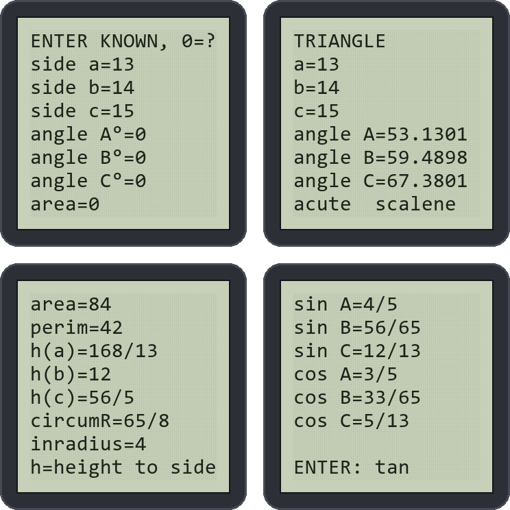</p>

<p align="center">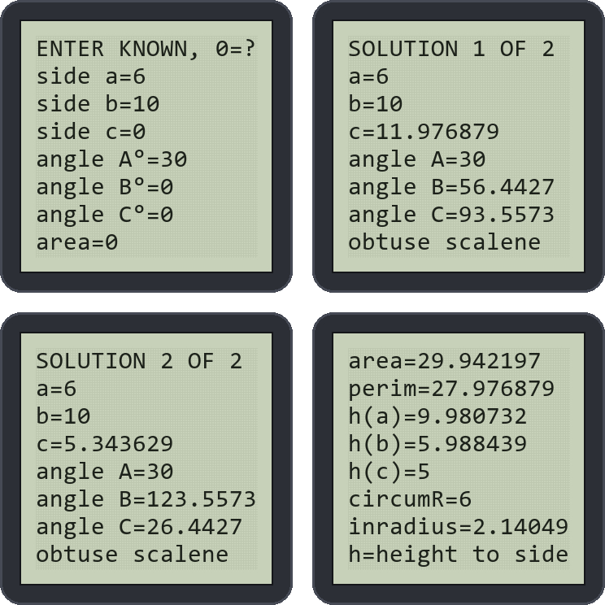</p>

### All trig tools

<p align="center">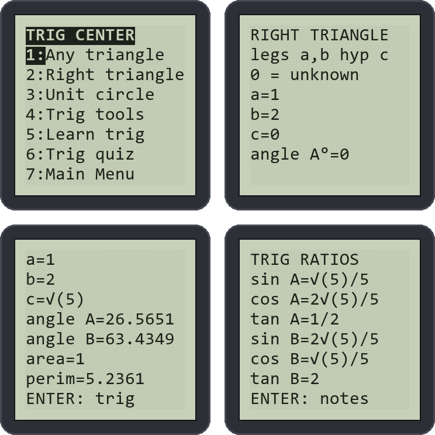</p>

| Tool | What it does |
|---|---|
| **Any triangle** | Any combination of sides, angles and area, as described above |
| **Right triangle** | A quicker version for right triangles: enter **any two sides, or one side and one angle**. You get every side in exact form, both angles, area, perimeter, sin/cos/tan of *both* acute angles, and notes that flag 30-60-90, 45-45-90 and Pythagorean triples |
| **Special triangles** (in Trig tools) | 30-60-90 or 45-45-90: give any one side, even as `4√(3)`, and get all three sides, the area and the perimeter in exact form |
| **Unit circle** | Enter any angle in degrees or radians (negative or over 360° works too). You get the coterminal angle, radians in π units, quadrant, reference angle, exact sin/cos/tan, and the sign of each |
| **Cofunction equation** | The classic `sin(ax+b)° = cos(cx+d)°`: solves for x and shows both angles |
| **Law of sines / cosines** | Two angles and a side, two sides and the included angle, or all three sides. You get the missing sides, angles and area (Heron's formula for three sides) |
| **Similar triangles** | Scale factor, the matching side, and the area (k²) and volume (k³) ratios |
| **Learn trig** | 6 lessons in 36 pages: SOH CAH TOA, special triangles, the unit circle (tables, quadrant signs, reference angles), radians and arcs, identities (cofunctions, sin²+cos²=1), and the traps the SAT sets |
| **Trig quiz** | 10 generated question types: triangle ratios, cofunction equations, special triangles, exact unit-circle values, radian conversion, arc length and sector area, complements, missing sides, tan → sin/cos, and finding angles. You can type exact answers like `√(3)/2`, and the feedback shows the exact answer |

<p align="center">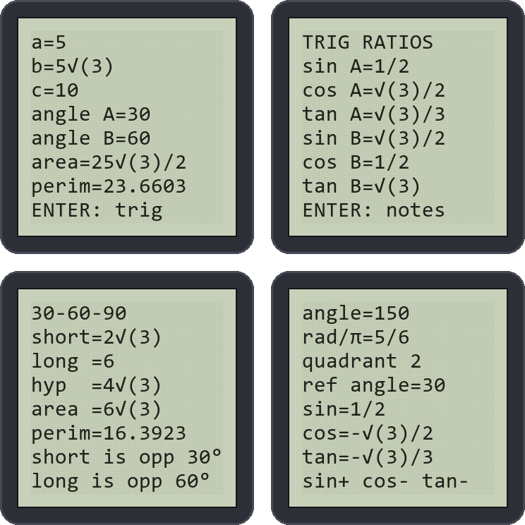</p>

<p align="center">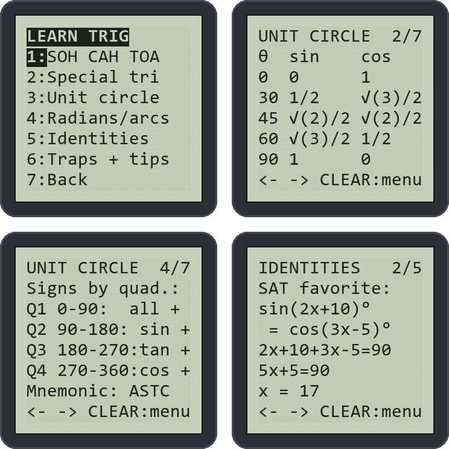</p>

<p align="center">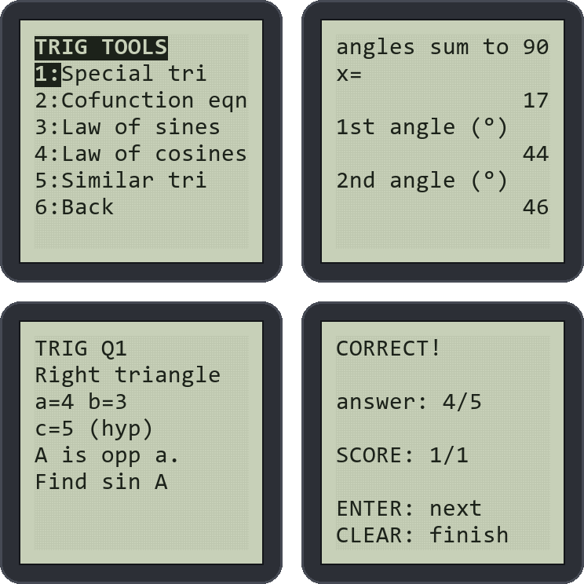</p>

All trig tools work in **Degree or Radian mode**. Angles are entered with the `°` symbol internally, so your calculator's mode setting doesn't matter.

## Screenshots

> These are rendered from the program running in the repo's TI-BASIC simulator ([`tools/`](tools)). They show exactly what the program draws on the calculator's 16×8 home screen.

### Menus

<p align="center">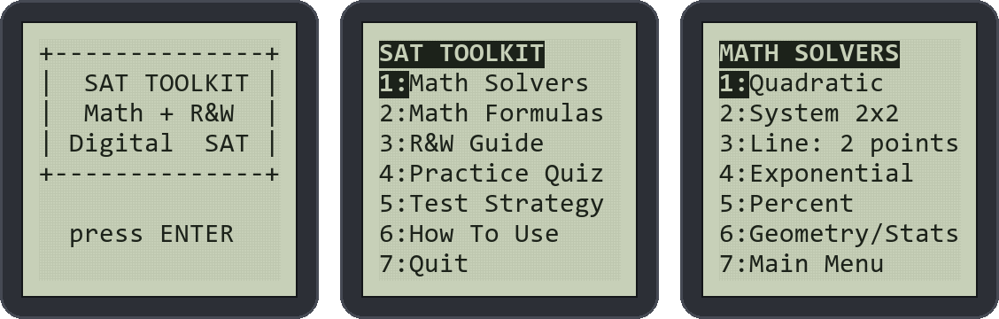</p>

### Quadratic solver

Type in a, b and c to get the discriminant, both roots, the exact simplified radical form, the vertex, min/max, and the sum and product of the roots.

<p align="center">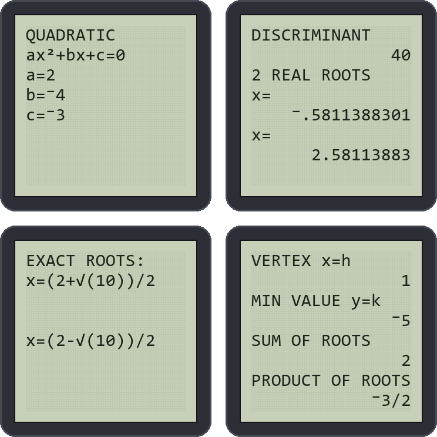</p>

### More solvers

Line through two points, and a circle from `x²+y²+dx+ey+f=0` with an exact simplified radius.

<p align="center">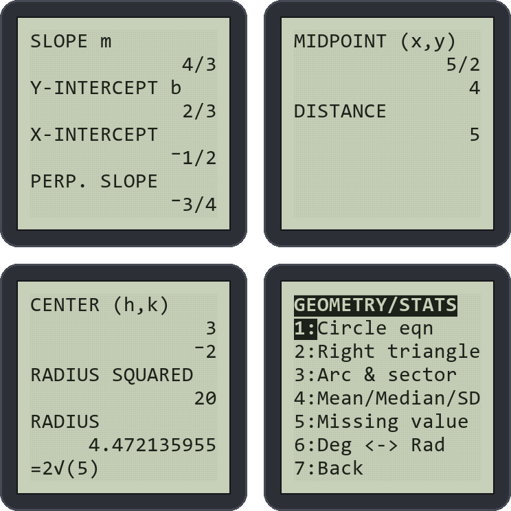</p>

### Formula & R&W reference

Every topic is a set of pages you flip with the arrow keys.

<p align="center">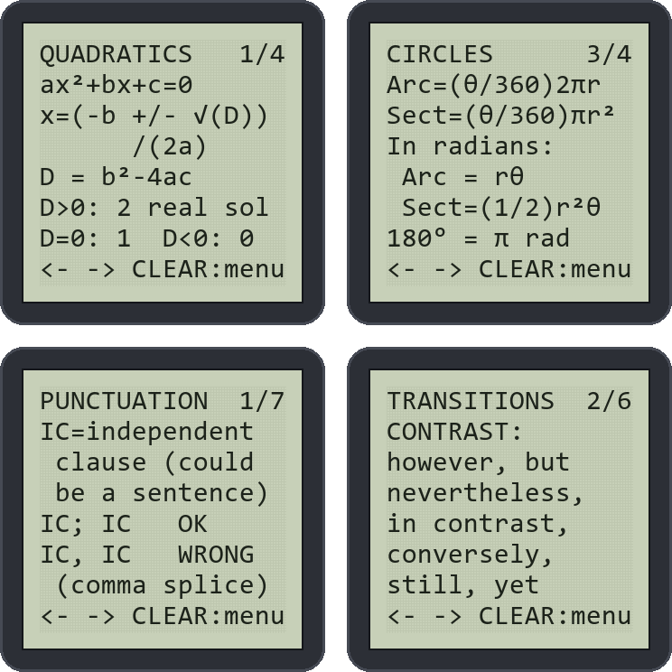</p>

### Practice quizzes

<p align="center">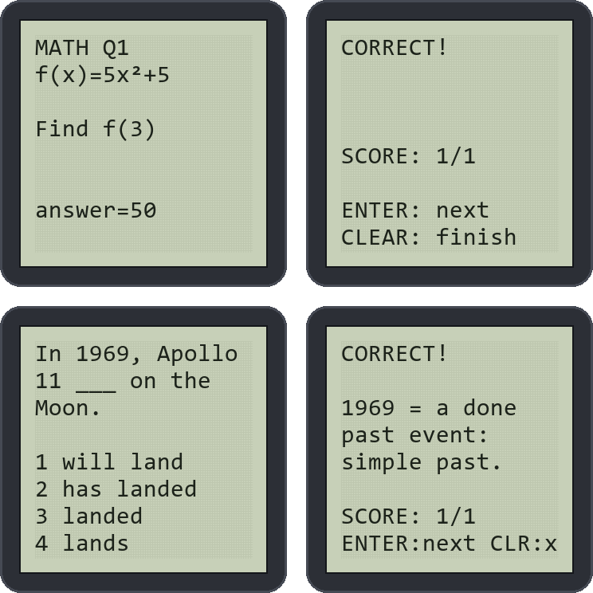</p>

## Which file do I need?

| Your calculator | How to tell | Download |
|---|---|---|
| **TI-84 Plus CE** | Color screen, rechargeable battery | `SAT.8xp` (56 KB): everything in one program |
| **TI-84 Plus / Silver Edition** | Gray screen, AAA batteries | `SATMATH.8xp`, `SATTRIG.8xp`, `SATRW.8xp` |

The older TI-84 Plus only has about 24 KB of RAM, so its version is split into three programs with uppercase text, which takes half the space:

- **SATMATH** (17 KB): math solvers, formulas, math quiz, strategy
- **SATTRIG** (21 KB): the full Trig Center, with its menu as the main menu
- **SATRW** (12 KB): Reading & Writing guide, grammar quiz, strategy

Only one fits in RAM at a time, so keep the others **archived**. SATTRIG is the largest, so archive or delete other programs and big lists first if you get `ERR:MEMORY`. Press `2nd` `+` (MEM) → `2:Mem Mgmt/Del` → `7:Prgm`, then press `ENTER` on a program to archive or unarchive it (a `*` means archived). Older models can't run archived programs.

## Install

1. Download the file(s) from the [latest release](https://github.com/aidanbologna/TI84-SAT/releases/latest), or from the [`TI-84 Plus CE`](TI-84%20Plus%20CE) and [`TI-84 Plus (older models)`](TI-84%20Plus%20(older%20models)) folders.
2. Install **TI Connect CE** (free from [education.ti.com](https://education.ti.com/en/products/computer-software/ti-connect-ce-sw)).
3. Connect the calculator with its USB cable and turn it on.
4. Drag the `.8xp` file into TI Connect CE and choose **Send to calculator**.
5. On the calculator, press `prgm`, choose **SAT** (or **SATMATH** / **SATTRIG** / **SATRW**), then press `ENTER` twice.

## Controls

| Key | Action |
|---|---|
| Number keys or `ENTER` | Pick a menu item |
| `←` `→` (or `ENTER`) | Previous / next page in a reference topic |
| `CLEAR` | Leave a topic or end a quiz |
| `1`–`4` | Answer a grammar question |
| `(-)` | Type a negative number (not the minus key) |
| `2nd` `x²` | Type `√(` for exact answers like `4√(3)` |
| `ON` | Break out of the program at any time |

Fractions work anywhere a number is asked for, so `2/3` is fine. Where angles are asked for in radians, you can type `π/3` using the `π` key.

## Solver reference

| Solver | You enter | You get |
|---|---|---|
| Quadratic | a, b, c | Discriminant, number of real roots, roots, exact radical roots, complex roots `p ± qi`, vertex, min/max, sum and product of roots |
| System 2×2 | `ax+by=c`, `dx+ey=f` | The solution, or "no solution" / "infinitely many" |
| Line: 2 points | (x1, y1), (x2, y2) | Slope, y-intercept, x-intercept, perpendicular slope, midpoint, distance (also as a simplified radical) |
| Exponential | Start, rate %, times per year, years | End value, yearly growth factor, total % change |
| Exponential rate | Start, end, periods | Growth factor and % rate per period |
| Percent | Six tools | % change, x% of y, x is ?% of y, undo a % change, stacked % changes, proportion `a/b = c/x` |
| Circle | `ax²+ay²+dx+ey+f=0` | Center, r², r, exact radical r |
| Arc & sector | Radius, angle (degrees or radians) | Arc length, sector area (both also in π units), fraction of the circle, circumference |
| Mean/Median/SD | A list like `{2,5,9}` | Mean, median, range, SD, count, sum, min/max, sorted list |
| Missing value | Count, current mean, target mean | The value needed to hit the target |
| Deg ↔ Rad | An angle | The converted angle, with radians in π units |
| Right triangle | Any 2 sides, or 1 side + angle A | Exact sides, both angles, area, perimeter, all six ratios (sin/cos/tan of A and B), special-triangle notes |
| Special triangle | One side of a 30-60-90 or 45-45-90 | All sides, area and perimeter, exact |
| Unit circle | Angle (deg or rad) | Coterminal angle, rad/π, quadrant, reference angle, exact sin/cos/tan, signs |
| Cofunction | a, b, c, d in `sin(ax+b)=cos(cx+d)` | x and both angles |
| Law of sines | 2 angles + a side | Third angle, other sides, area |
| Law of cosines | SAS or SSS | Missing side and angles, area |
| Similar triangles | Matching sides | Scale factor, matching side, area and volume ratios |

## Building from source

All screen text and program logic lives in one file, [`build_sat.py`](build_sat.py). It writes TI-BASIC from templates and tokenizes it into `.8xp` files with [tivars](https://pypi.org/project/tivars/).

```bash
pip install tivars
```

```bash
python build_sat.py
```

That regenerates all four programs:

```
SAT       3832 lines  56165 bytes
SATMATH   1332 lines  16974 bytes
SATTRIG   1813 lines  20935 bytes
SATRW      842 lines  11822 bytes
```

The build fails if any line of text is too wide for the 16-character screen, if a label is missing, if a block is unbalanced, or if a `Goto` jumps out of an `If`/loop block. On a real TI, that last one slowly leaks memory until `ERR:MEMORY`. The readable TI-BASIC listings are written to [`source/`](source).

TI-BASIC has no subroutines, so the exact-value engine is shared through a jump table. Each call stores its arguments, jumps to the routine at the top of the program, and the routine jumps back by return id.

## Testing

[`tools/sim.py`](tools/sim.py) is a small TI-BASIC interpreter for the subset this program uses. It models the 16×8 home screen, `Disp` scrolling, `Output(` wrapping, `►Frac`, Degree/Radian mode, and real TI behavior such as `and` not short-circuiting, `√(` of a negative raising `ERR:NONREAL ANS`, and `Output(` past column 16 raising `ERR:DOMAIN`.

```bash
python tools/test_solvers.py
```

```bash
python tools/test_trig.py
```

```bash
python tools/test_all.py
```

- `test_solvers.py` runs 36 math solver cases with known answers, including edge cases (a = 0, complex roots, vertical lines, invalid input).
- `test_trig.py` runs 48 Trig Center cases and checks the exact text on screen. For example, legs 1 and 2 give `cos A=2√(5)/5`, 150° gives `cos=-√(3)/2`, a 13-14-15 triangle gives `sin B=56/65`, and SSA with a=6, b=10, A=30° gives two solutions. It also runs 400 random fuzz inputs through the any-triangle solver.
- `test_all.py` flips through every reference page in all four builds, plays all three quizzes (checking the final score and that every question type appears), and runs 600 random fuzz walks with odd inputs (0, negatives, fractions, π) in both angle modes, failing on any crash or screen overflow.

To regenerate the README images and demo GIF (needs Pillow, and uses the Windows Consolas font):

```bash
python tools/screenshots.py
```

## Project layout

```
TI84-SAT/
├── build_sat.py                  # all content + program logic → .8xp
├── TI-84 Plus CE/SAT.8xp         # full program (CE)
├── TI-84 Plus (older models)/
│   ├── SATMATH.8xp               # math (TI-84 Plus / SE)
│   ├── SATTRIG.8xp               # trig center
│   └── SATRW.8xp                 # reading & writing
├── source/                       # readable TI-BASIC listings
├── tools/
│   ├── sim.py                    # TI-BASIC simulator
│   ├── test_solvers.py           # math solver cases
│   ├── test_trig.py              # trig cases (exact on-screen text)
│   ├── test_all.py               # pages, quizzes, fuzzing
│   └── screenshots.py            # README images + demo GIF
└── docs/images/                  # screenshots
```

## Notes

- The program uses variables **A–Z**, **θ** and list **L6**, and overwrites whatever was in them.
- Calculators are only allowed during the **Math** section of the SAT. The Reading & Writing content is for studying beforehand.
- Check the College Board's current calculator policy before test day.
- The screenshots come from the simulator, not photos of a calculator. On a TI-84 Plus CE the same text appears in the top-left of its larger screen.
- This project is not affiliated with or endorsed by the College Board or Texas Instruments. SAT is a trademark of the College Board, and TI-84 is a trademark of Texas Instruments.
